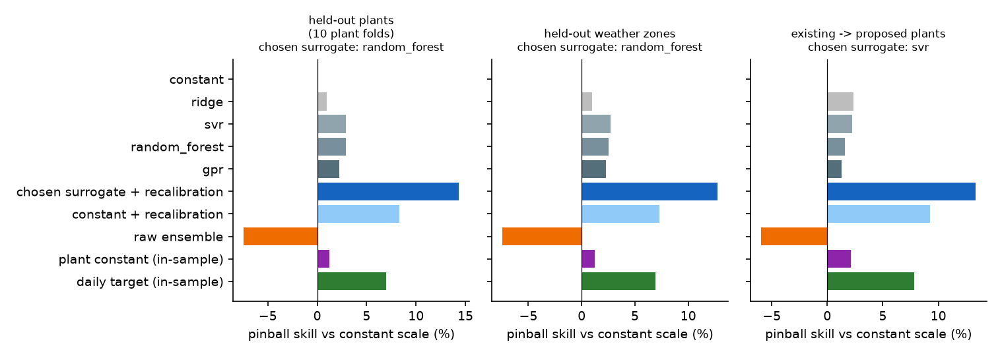
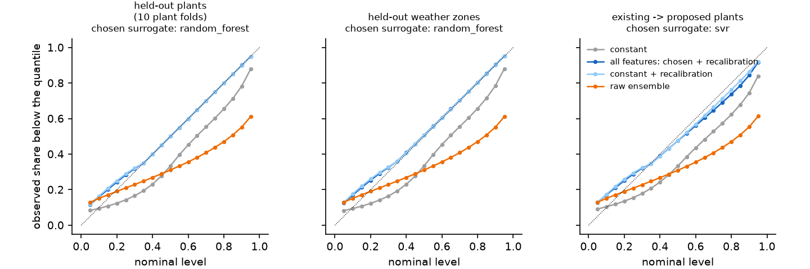
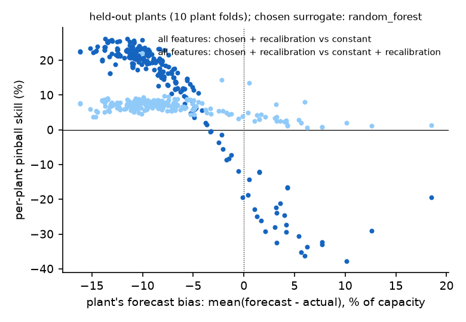

# Case study: 264 ERCOT wind plants on public data (ARPA-E PERFORM, 2018)

The surrogate workflow of this repository applied to a public data set with many plants, and checked against simple and strong references. Everything here can be rerun from the publisher's files with the four scripts below.

## Question

At a wind plant without power measurements, only the inputs of the forecast are known: here, a day-ahead ensemble of 51 power forecasts. Can a surrogate trained at other plants turn UQ metrics of these inputs into calibrated predictive distributions at the unmeasured plant, and how does it compare with

- one constant scale for every plant (the same location, the same distribution family),
- the raw ensemble (its members' empirical quantiles), and
- references that use the plant's own power: one scale fitted to the plant's whole year, and the daily scales fitted in sample?

## Data

[ARPA-E PERFORM data sets](../../data/README.md), ERCOT, 2018, all 264 wind plants (125 existing, 139 proposed) in eight ERCOT weather zones; 8,760 hours per plant. Licence CC BY 3.0 US; citation and the list of files with their SHA-256 in [data/README.md](../../data/README.md) and [`data_manifest.csv`](data_manifest.csv).

The plant power in PERFORM is **simulated**: WIND Toolkit meteorology converted to power with plant configurations, at the locations of operating plants (existing) and of interconnection-queue sites (proposed). The ensemble forecasts are ECMWF ensemble forecasts converted with the same configurations. Forecast errors therefore come from the weather forecast and the conversion; curtailment, outages and metering errors are absent. The results describe the method on a consistent public benchmark, not the uncertainty of any real plant's output.

## Design

| Element | Choice |
|---|---|
| Point forecast (location) | mean of the 51 day-ahead members, issued once a day at 18:00 UTC (lead times 12–35 h; the 2-day-ahead forecasts used for the revision feature have 36–59 h) |
| Actual | hourly mean of the 5-minute simulated power, labelled at the start of the hour. PERFORM documents UTC times but not the convention of the hourly forecast intervals, so this is an assumption: it is the convention with the smallest median difference to the forecasts, over all plants and also over the plants observed in each design (existing plants; all plants but one zone); `results/prepare_summary.json`, `results/alignment.csv` |
| Per unit | all power divided by the plant's installed capacity (`capacity_mw`) |
| Features (7) | trailing 24-hour standard deviation of the forecast; trailing 24-hour mean absolute revision between the 2-day-ahead and the day-ahead forecasts; spread of the members per unit (25–75 and 5–95 percentile widths, total range); predictability index of the 25–75 width over the previous 48 hours; the forecast level. All exist at every plant; none uses the plant's power |
| Target | Laplace scale around the point forecast that minimizes the mean pinball loss over the levels 0.05, …, 0.95, one per plant and day: blocks of 24 hours from 00:00 UTC on 1 January, which are UTC days because every series is hourly without gaps over 2018 (checked by `prepare.py` and `run.py`) (Step A of [docs/surrogate_workflow.md](../../docs/surrogate_workflow.md)) |
| Surrogates | Gaussian process regression (Matérn 5/2, one length scale per feature; 1,000 training rows per fit), random forest (200 trees; 200,000 rows), support vector regression (5,000 rows), ridge regression, constant (median target); all on the logarithm of the target |
| Recalibration | PIT recalibration of the chosen surrogate and of the constant, fitted without the held-out plants (nested plant folds) |
| Validation designs | `plants10`: 10 folds of plants (a held-out plant has observed neighbours); `zones`: leave one weather zone out (no observed plant in the zone); `proposed`: surrogates compared and recalibrated on the 125 existing plants, then applied to the 139 proposed plants |
| Ablation | the same runs with the forecast level as the only feature (`run.py --features level`), to separate what the UQ metrics add from what the level alone gives (the level is the only input of the surrogate in Sun et al., 2019) |
| References that use the plant's power | one scale per plant for its whole year, and the daily target scales themselves; both keep the forecast as the centre and are pinball-loss optimal for the unclipped distribution, so after clipping they are references, not bounds |
| Scores | on every held-out plant and every hour after the 48-hour warm-up of the metrics (8,712 hours per plant): mean pinball loss over 0.05, …, 0.95 (`pinball`); twice the mean over 0.01, …, 0.99 (`crps_q`, a quantile approximation of the CRPS); mean absolute error of the median; reliability; central 50% and 90% interval coverage and width. All per unit; every method's quantiles are clipped to [0, 1] |

## Results

All numbers are per unit of installed capacity, on 8,712 hours of every held-out plant (2.30 million plant-hours in `plants10` and `zones`, 1.21 million at the 139 proposed plants). Lower pinball loss is better; "skill" is the relative reduction against the constant scale. Full tables: `results/scores_*.csv`; per plant: `results/per_plant_*.csv`.

| Method | Needs the plant's power? | `plants10` pinball (%) | skill | `zones` pinball (%) | skill | `proposed` pinball (%) | skill |
|---|---|---:|---:|---:|---:|---:|---:|
| constant scale | no | 4.65 | — | 4.65 | — | 5.04 | — |
| chosen surrogate, all features, no recalibration | no | 4.51 | +2.9% | 4.53 | +2.5% | 4.93 | +2.3% |
| constant + recalibration | no | 4.26 | +8.3% | 4.31 | +7.3% | 4.57 | +9.3% |
| **chosen surrogate, all features + recalibration** | no | **3.98** | **+14.3%** | **4.06** | **+12.7%** | **4.37** | **+13.4%** |
| **chosen surrogate, forecast level only + recalibration** (ablation) | no | **3.99** | **+14.2%** | **4.03** | **+13.3%** | **4.33** | **+14.0%** |
| raw ensemble (51 members) | no | 4.99 | −7.4% | 4.99 | −7.4% | 5.34 | −6.0% |
| plant constant (in-sample) | yes | 4.59 | +1.2% | 4.59 | +1.2% | 4.93 | +2.1% |
| daily target (in-sample) | yes | 4.32 | +6.9% | 4.32 | +6.9% | 4.65 | +7.8% |

The chosen surrogate (lowest cross-validated pinball loss before recalibration, among the five) is the random forest with all features in `plants10` and `zones`, and support vector regression in `proposed` and in every level-only run.



What the results show, within the limits below:

1. **At unmeasured plants, a recalibrated surrogate is clearly better than one constant scale.** It lowers the pinball loss by 12.7–14.3% against the constant scale, and by 4.5–6.6% against the constant scale with the same recalibration, at every held-out plant in `plants10` and `proposed` and at 261 of 264 plants in `zones`.
2. **On these data, the UQ metrics of the ensemble add nothing beyond the forecast level.** With the same validation and recalibration, a surrogate that uses only the forecast level (the single input of the method of Sun et al., 2019) is as good as the one with all seven features: 3.99% against 3.98% of capacity in `plants10`, and slightly better in `zones` (4.03% against 4.06%) and `proposed` (4.33% against 4.37%). Ensemble spread and level are about equally related to the daily target scale (Spearman correlation 0.44–0.45 with its logarithm in `plants10`; `results/feature_correlation_*.csv`), and the spread brings no information that the level does not already carry. The random forest with all features explains 35–42% of the variance of the log target at held-out plants (`results/scale_scores_*.csv`).
3. **Holding out whole regions costs little.** Leaving out an entire weather zone changes the pinball loss of the recalibrated surrogate from 3.98% to 4.06% of capacity (all features); training on the existing plants and predicting the proposed ones gives a similar skill.
4. **The raw ensemble is too narrow.** Its central 90% interval contains the simulated power in 55% of the hours, and its pinball loss is worse than the constant scale at 96–99% of the plants.
5. **The plant-to-plant differences follow the forecast bias.** The ensemble-mean forecast is on average lower than the simulated power: the median plant bias is −9.2% of capacity (10th–90th percentile −13.1% to +0.2%; range −16.2% to +18.5%; `results/forecast_summary.csv`). The recalibration is fitted at other plants and is the same for all plants. It moves the quantiles towards the average bias: the mean absolute deviation of the reliability curve falls from about 0.12 to 0.015–0.043, and the mean absolute error of the median from 11.9% to 10.7% of capacity (`plants10`). Per-plant skill against the constant scale falls with the plant's bias (correlation −0.93 in `plants10`). In `plants10`, 37 of 264 plants (29 in the North zone) end up worse than the constant scale: they are the plants with a bias above −3.3% of capacity, 27 of them with a positive bias, while every plant with a bias below −3.7% gains. Against the recalibrated constant, the surrogate improves these plants too. A model of the location (bias) learned across plants is the natural next step; it is not part of this framework.
6. **A plant's own constant scale adds little.** Fitting one scale per plant on its whole year (which needs its measurements) improves the pooled constant by only 1–2%: in these data the error scale varies more with conditions than between plants.





## Limits of these results

- **Simulated power.** PERFORM's plant power is simulated from a mesoscale data set; the forecast errors here are differences between two model chains (ECMWF ensemble forecasts and WIND Toolkit meteorology, both converted to power). Real plants add curtailment, outages, wake and availability effects and measurement errors.
- **One region, one year, one forecast system:** ERCOT, 2018, day-ahead ECMWF ensemble; hourly resolution; daily target scales. Finding 2 concerns the metrics computable from these files (forecast variability, forecast revision, ensemble spread); data-source disagreement between different weather products and turbine-level spatial metrics, which the framework also provides, cannot be tested with PERFORM.
- **Same weather, different plants.** In `plants10` a held-out plant shares the weather of nearby training plants on the same days; `zones` removes neighbours of the same zone but not the shared year.
- **Scale only, plus one global recalibration.** The surrogate predicts a scale around the given forecast; the location is corrected only by the recalibration, which is the same for all plants (finding 5).
- **Model choice and recalibration.** In `plants10` and `zones` the surrogate is chosen with the same plant folds that are reported, which makes its scores optimistic by an amount not quantified here (in `proposed` the choice uses the existing plants only); the recalibration of the chosen surrogate is validated with nested plant folds. The choice uses the unclipped pinball loss, the reported scores the clipped one. Quantiles of every method are clipped to [0, 1] per unit.
- **Capacity.** Power is divided by the installed capacity of the PERFORM metadata; the largest simulated output reaches a median of 90% of it (`results/forecast_summary.csv`).

## Rerun the case study

Needs Python 3.10 or newer, about 3 GB of disk for the downloaded files and about 2 GB for the prepared inputs.

```bash
pip install -e ".[case-study]"                               # from the repository root
python case_studies/perform_ercot/download.py raw/           # 793 files, 2.7 GB; compare raw/manifest.csv with data_manifest.csv
python case_studies/perform_ercot/prepare.py raw/ prepared/  # input directory and alignment check
for d in plants10 zones proposed; do
  python case_studies/perform_ercot/run.py prepared/ results/ --design $d --jobs 16
done
for d in plants10 zones proposed; do                         # the level-only ablation
  python case_studies/perform_ercot/run.py prepared/ results/ --design $d --features level --jobs 16
done
python case_studies/perform_ercot/figures.py results/
```

Measured on a 128-core Linux workstation (Python 3.12), with the six runs in parallel and up to 20 threads each: download and preparation a few minutes; 7–18 minutes per run with all features and 7–38 minutes per level-only run, cross-validation included (`results/design_*.json`, `runtime_s`). The level-only runs take longer because their chosen surrogate, SVR, predicts on one thread in the nested recalibration. `run.py --cache DIR` stores the cross-validated predictions with a fingerprint of the training table, the settings and the folds, and reuses them only when the fingerprint matches. Running `prepare.py` three times gave byte-identical input files, and rerunning `run.py` gave identical score tables.

Random seeds are fixed (`random_state=0` for the row subsets and the estimators); the GP fits depend on the optimizer and BLAS, so the last digits can differ between machines.
